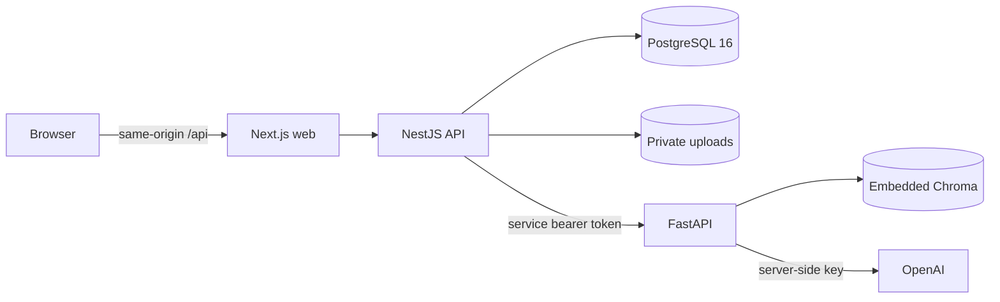

# Architecture and business rules

## State and boundaries

- Redux contains volatile auth/org identity and UI preferences; authentication credentials are never put in Redux or browser storage. Only appearance is persisted locally.
- React Query keys include the organization ID. Queries receive cancellation signals, and session/account changes clear caches.
- NestJS verifies JWT issuer/audience, the current membership and an unexpired server-side refresh session on every protected request. A role change, password change, membership removal or employee termination ends access.
- Tenant identity comes from the verified session, never a request-supplied organization ID. Employee scope combines the requested ID with an independent self/report-tree predicate; IDs cannot replace that predicate.
- PostgreSQL is the system of record. Files are opaque UUID objects stored outside public web directories. Downloads re-check access and refresh expired browser sessions through the API client.

## Authentication

Access JWTs expire after 15 minutes. Random refresh tokens are stored as SHA-256 hashes, rotate through a compare-and-swap update and expire after seven days. Cookies are HttpOnly, SameSite=Lax and Secure in production. Mutation origins and Fetch Metadata are checked. Passwords use bcrypt cost 12 and enforce its 72-byte limit. Unknown-login responses do not reveal account existence.

## Employee lifecycle

Employee numbers come from an organization sequence inside a transaction. Relationships are checked within the tenant. Manager updates walk the reporting chain and reject cycles under serializable isolation. Archival preserves history, protects the owner's own record and records an end date; reactivation clears an old end date unless explicitly supplied.

Custom fields support at most 20 text values, with bounded names/values and reserved object keys rejected. They are part of private profile details.

## Leave accounting

Dates are calendar dates stored at UTC midnight. Each policy/employee/year has a unique balance. Working days are counted inclusively using `Organization.workWeekdays` (Monday–Friday by default). Requests must stay inside a calendar year and cannot overlap another pending/approved request. Pending requests reserve availability.

Approvals use a serializable transaction with bounded conflict retries and a conditional balance decrement. A reviewed request cannot be approved again. Rejection preserves balances. A pending or future approved request can be cancelled; approved days are refunded once. Self-approval is forbidden. Managers approve only their report tree. Flat annual entitlement is implemented; accrual, carryover, public holidays and country-specific compliance are not inferred.

## Hiring and onboarding

Hiring requires an open role and an Offer-stage candidate. Employee creation, balance initialization, default-template checklist creation, candidate linkage and audit events commit together. Repeated/concurrent hire calls return the same employee. A hired candidate cannot be dragged to another stage or deleted.

Checklist steps represent work coordinated with the team; checking an account/laptop task does not provision external accounts or equipment. Completing the checklist activates an Onboarding employee. Existing checklists retain their tasks when templates change.

## AI and retrieval

NestJS supplies tenant identity and a fresh allowlist of indexed, company-wide policy documents. Employee-private files can never be marked as handbook sources. FastAPI accepts only the shared service token; Chroma HTTP endpoints are not mounted.

Handbooks are chunked and embedded into hashed tenant-specific persistent collections. Re-indexing replaces obsolete chunks. Embeddings are supplied explicitly and collection embedding plugins are disabled. Retrieval is filtered by the server-generated document allowlist. Model source IDs must match retrieved chunks; NestJS also filters document IDs. Missing context, unsupported answers or invented citations produce a refusal. Deleted documents disappear from subsequent allowlists immediately.

JD generation and screening use validated structured outputs. Screening persists evidence/gaps on the candidate and rejects stale writes if the candidate changed during the provider call. Replacing resume text/file clears the previous assessment. Provider calls have timeouts; failed indexing remains retryable. Obvious identity numbers are redacted before screening and request bodies/resumes are not logged.

## Reports and release scope

Headcount uses start/end dates and department/location groups. Joiners/leavers use monthly dates. Leave utilization compares approved days to initialized entitlement plus uninitialized active-employee allowances. Recruiting conversion is hired candidates divided by total candidates per role, with current-stage counts shown separately. CSV cells are escaped against spreadsheet formula injection.

This deployment targets one API instance and one AI process with durable local volumes. Horizontal scaling requires shared uploads, a reviewed shared-vector architecture and an edge/shared rate limiter. Audit records and business changes are committed together. External telemetry and third-party business integrations require operator configuration.
